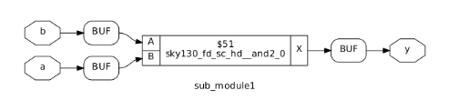

# SKY130 RTL Design and Synthesis Workshop

A comprehensive technical journal and lab documentation covering the **5-Day RTL Design, Simulation, and Logic Synthesis Workshop using SKY130 Technology**, conducted by **VLSI System Design (VSD)** and mentored by **Kunal Ghosh**.

---

## 📌 Table of Contents
1. [Workshop Overview & Toolset](#1-workshop-overview--toolset)
2. [Environment Setup & Installation](#2-environment-setup--installation)
3. [Cloning Kunal Ghosh Sir's Workshop Repository](#3-cloning-kunal-ghosh-sirs-workshop-repository)
4. [Directory Structure & Collateral Walkthrough](#4-directory-structure--collateral-walkthrough)
   - [A. Standard Cell Timing Library (`lib/`)](#a-standard-cell-timing-library-lib)
   - [B. Standard Cell Verilog Models (`my_lib/verilog_model/`)](#b-standard-cell-verilog-models-my_libverilog_model)
   - [C. RTL Designs and Testbenches (`verilog_files/`)](#c-rtl-designs-and-testbenches-verilog_files)
5. [Day 1: Theory of RTL Design & Simulation](#5-day-1-theory-of-rtl-design--simulation)
   - [What is Design?](#what-is-design)
   - [What is a Simulator?](#what-is-a-simulator)
   - [How Simulator Works (Event-Driven Simulation)](#how-simulator-works-event-driven-simulation)
   - [What is a Testbench?](#what-is-a-testbench)
   - [The 3-Step Simulation Flow (`iverilog` & `GTKWave`)](#the-3-step-simulation-flow-iverilog--gtkwave)
   - [Deep Dive: Working with GTKWave](#deep-dive-working-with-gtkwave)
   - [Working with Text Editors: GVim & Vim Commands](#working-with-text-editors-gvim--vim-commands)
   - [Lab 1: Behavioral Simulation of 2:1 Multiplexer (`good_mux.v`)](#lab-1-behavioral-simulation-of-21-multiplexer-good_muxv)
   - [Lab 2: Logic Synthesis with Yosys (`good_mux.v`)](#lab-2-logic-synthesis-with-yosys-good_muxv)
   - [Synthesized Netlist Generation (`write_verilog -noattr`)](#synthesized-netlist-generation-write_verilog--noattr)
6. [Day 2: Timing Libraries, Hierarchical vs Flat Synthesis & Multipliers](#6-day-2-timing-libraries-hierarchical-vs-flat-synthesis--multipliers)
   - [Introduction to Liberty (`.lib`) Files & PVT Corners](#introduction-to-liberty-lib-files--pvt-corners)
   - [Hierarchical Synthesis (`multiple_modules.v`)](#hierarchical-synthesis-multiple_modulesv)
   - [Flat Synthesis (`flatten`)](#flat-synthesis-flatten)
   - [Sub-Module Level Synthesis (`sub_module1`)](#sub-module-level-synthesis-sub_module1)
   - [Hardware Optimization for Multipliers (`mult_2.v`)](#hardware-optimization-for-multipliers-mult_2v)
7. [Day 3: Combinational and Sequential Logic Optimizations](#7-day-3-combinational-and-sequential-logic-optimizations)
   - [Combinational Logic Optimization (`opt_check.v`, `opt_check3.v`)](#combinational-logic-optimization-opt_checkv-opt_check3v)
   - [Sequential Logic Optimization: Constant Flop Optimization (`dff_const1` to `dff_const4`)](#sequential-logic-optimization-constant-flop-optimization-dff_const1-to-dff_const4)
   - [Sequential Logic Optimization: Unused Flop Elimination (`counter_opt.v` vs `counter_opt2.v`)](#sequential-logic-optimization-unused-flop-elimination-counter_optv-vs-counter_opt2v)
8. [Day 4: Gate-Level Simulation (GLS), Blocking vs Non-Blocking Statements & Synthesis-Simulation Mismatch](#8-day-4-gate-level-simulation-gls-blocking-vs-non-blocking-statements--synthesis-simulation-mismatch)
   - [What is Gate-Level Simulation (GLS)?](#what-is-gate-level-simulation-gls)
   - [GLS Invocation Flow & Model Dependencies](#gls-invocation-flow--model-dependencies)
   - [Lab 1: Synthesis & GLS of 2:1 MUX (`ternary_operator_mux.v`)](#lab-1-synthesis--gls-of-21-mux-ternary_operator_muxv)
   - [Lab 2: Synthesis-Simulation Mismatch: Incomplete Sensitivity List (`bad_mux.v`)](#lab-2-synthesis-simulation-mismatch-incomplete-sensitivity-list-bad_muxv)
   - [Lab 3: Synthesis-Simulation Mismatch: Blocking Assignment Caveats (`blocking_caveat.v`)](#lab-3-synthesis-simulation-mismatch-blocking-assignment-caveats-blocking_caveatv)
9. [Synthesis and Simulation Command Quick Reference](#9-synthesis-and-simulation-command-quick-reference)
10. [Author & Acknowledgements](#10-author--acknowledgements)

---

## 1. Workshop Overview & Toolset

This workshop covers frontend digital IC design: from writing behavioral Verilog RTL code, verifying functionality with event-driven simulation, mapping to technology cells via logic synthesis with Yosys, and performing combinational/sequential logic optimizations using the open-source **SkyWater 130nm PDK**.

### Primary EDA Tools
| Tool | Category | Role in Flow |
| :--- | :--- | :--- |
| **Icarus Verilog (`iverilog`)** | Verilog Simulator | Compiles RTL design and testbench into an executable simulation engine (`a.out`). Performs event-driven evaluation and generates Value Change Dump (`.vcd`) waveforms. |
| **GTKWave** | Waveform Viewer | Graphical tool to trace digital signals, clock transitions, and bus transitions across simulation time. |
| **Yosys** | Logic Synthesizer | Translates behavioral Verilog into optimized gate-level netlists mapped to physical standard cells in the target technology. |
| **SkyWater 130nm PDK** | Open Foundry Collaterals | High-Density (`sky130_fd_sc_hd`) standard cell library, liberty (`.lib`) timing definitions, and Verilog simulation primitives. |

---

## 2. Environment Setup & Installation

All tools were configured inside Ubuntu 22.04 LTS running on Windows Subsystem for Linux (WSL2):

```bash
# Update Ubuntu package lists
sudo apt-get update

# Install simulation, synthesis tools, and text editors
sudo apt-get install -y iverilog gtkwave yosys vim-gtk3 git
```

---

## 3. Cloning Kunal Ghosh Sir's Workshop Repository

The official workshop collaterals repository created by **Kunal Ghosh sir** contains all standard cell timing libraries, gate models, and lab designs.

```bash
# Navigate to home directory and create VLSI workspace
cd ~
mkdir -p VLSI
cd VLSI

# Clone Kunal sir's official workshop repository
git clone https://github.com/kunalg123/sky130RTLDesignAndSynthesisWorkshop.git

# Enter the workshop directory
cd sky130RTLDesignAndSynthesisWorkshop
```

---

## 4. Directory Structure & Collateral Walkthrough

```text
~/VLSI/sky130RTLDesignAndSynthesisWorkshop/
├── DC_WORKSHOP/                        # Reference collaterals
├── README.md                           # Course README
├── yosys_run.sh                        # Synthesis automation script
├── lib/                                # Standard cell timing (.lib) libraries
│   └── sky130_fd_sc_hd__tt_025C_1v80.lib
├── my_lib/                             # Gate models for Gate-Level Simulation (GLS)
│   └── verilog_model/
│       ├── primitives.v                # Gate primitives
│       └── sky130_fd_sc_hd.v           # Consolidated behavioral cell models
└── verilog_files/                      # RTL source designs and testbenches
    ├── good_mux.v, tb_good_mux.v
    ├── multiple_modules.v
    ├── mult_2.v, mult_8.v
    ├── opt_check.v, opt_check2.v, opt_check3.v, opt_check4.v
    ├── dff_const1.v - dff_const5.v, tb_dff_const1.v - tb_dff_const5.v
    ├── counter_opt.v, counter_opt2.v
    └── ...
```

### A. Standard Cell Timing Library (`lib/`)
Contains technology timing information, cell delays, and power models at standard PVT (Process, Voltage, Temperature) corners:
- **Path:** `~/VLSI/sky130RTLDesignAndSynthesisWorkshop/lib/`
- **File:** `sky130_fd_sc_hd__tt_025C_1v80.lib` (Typical corner, 25°C, 1.8V)
- **Access command:**
  ```bash
  cd ~/VLSI/sky130RTLDesignAndSynthesisWorkshop/lib
  ls -lh
  ```

<!-- Add your timing library screenshot below -->
<!--  -->

---

### B. Standard Cell Verilog Models (`my_lib/verilog_model/`)
Contains functional models of standard cells used during post-synthesis Gate-Level Simulation (GLS):
- **Path:** `~/VLSI/sky130RTLDesignAndSynthesisWorkshop/my_lib/verilog_model/`
- **Files:** `primitives.v`, `sky130_fd_sc_hd.v`
- **Access command:**
  ```bash
  cd ~/VLSI/sky130RTLDesignAndSynthesisWorkshop/my_lib/verilog_model
  ls -lh
  ```

<!-- Add your verilog models screenshot below -->
<!--  -->

---

### C. RTL Designs and Testbenches (`verilog_files/`)
Contains all Verilog RTL designs and testbench files for the workshop:
- **Path:** `~/VLSI/sky130RTLDesignAndSynthesisWorkshop/verilog_files/`
- **Access command:**
  ```bash
  cd ~/VLSI/sky130RTLDesignAndSynthesisWorkshop/verilog_files
  ls -la
  ```

<!-- Add your verilog files directory screenshot below -->
<!--  -->

---

## 5. Day 1: Theory of RTL Design & Simulation

### What is Design?
> **Design** is the synthesizable Verilog HDL code (or set of codes) written to implement specific architectural and behavioral specifications.

```text
       +-----------------------+
Inputs |                       | Outputs
-----> |      RTL DESIGN       | ------->
       |                       |
       +-----------------------+
```


---

### What is a Simulator?
- **RTL design is checked for adherence to the specifications by simulating the design.**
- **Simulator** is the software tool used for simulating the design before fabrication.


---

### How Simulator Works (Event-Driven Simulation)
- The simulator continuously **looks for changes on the input signals**.
- **Upon change to the input, the output is evaluated.**
- If there is no change on the inputs, the simulator does not evaluate outputs, saving simulation time and CPU resources.

```text
+--------------------+         Signal Change         +--------------------+
|   Input Stimulus   |  ===========================> |     Simulator      |
|    (Testbench)     |                               | (Evaluates Logic)  |
+--------------------+                               +--------------------+
                                                               ||
                                                               \/ Output Updated
                                                     +--------------------+
                                                     |    Output Wave     |
                                                     | (Dump to .vcd file)|
                                                     +--------------------+
```

---

### What is a Testbench?
- A **Testbench (`tb`)** is a Verilog wrapper code that applies input stimulus to the Design Under Test (**DUT**).
- It contains non-synthesizable timing statements (like `#10`, `$dumpfile`, `$dumpvars`, `$finish`) to generate clock, reset, and stimulus patterns.
- The simulator executes the testbench and records signal value transitions into a Value Change Dump (`.vcd`) file.


---

### The 3-Step Simulation Flow (`iverilog` & `GTKWave`)

```text
   [ RTL Design (.v) ]       [ Testbench (.v) ]
            \                       /
             \                     /
              v                   v
         +-----------------------------+
         |      iverilog compiler      |
         +-----------------------------+
                        |
                        v Generates executable engine
              [ Output executable ]
                        |
                        v Run: ./<output.out>
              [ Waveform Dump (.vcd) ]
                        |
                        v Run: gtkwave <dumpfile>.vcd &
              [ GTKWave GUI Viewer ]
```


---

### Deep Dive: Working with GTKWave

#### 1. Why GTKWave needs `.vcd` (Value Change Dump):
GTKWave is strictly a **waveform viewer** that parses digital transitions over time stored inside `.vcd` files. It cannot read Verilog HDL source text files (`.v`).
- Attempting to run `gtkwave design.v` will produce the error:
  `Near byte 17, VCD search table NULL..Is this a VCD file? Malformed!`
- Always compile with `iverilog` and execute `./a.out` first to produce the `.vcd` file before opening GTKWave.

#### 2. How to view signals inside GTKWave:
1. In the top-left **SST (Search Signal Tree)** panel, click on the testbench module (`tb_...`) or DUT instance.
2. In the bottom-left **Signals** box, select the desired signals (`clk`, `reset`, `q`, etc.).
3. Click the **Append** button (or press `Insert`) to add the signals to the waveform viewer.
4. **Zooming & Navigation:**
   - Click **Zoom Fit** (magnifying glass with box icon) to display the entire simulation duration across the screen.
   - Click **Zoom In (`+`)** or **Zoom Out (`-`)** to inspect transition details.
   - Click anywhere along the waveform trace to place a marker and read exact signal values at that timestamp.

---

### Working with Text Editors: GVim & Vim Commands

In digital design, inspecting testbenches and RTL designs side-by-side is done using **GVim**:

```bash
# Open two Verilog files in horizontal split view:
gvim tb_good_mux.v -o good_mux.v &
```

#### Essential Vim Shortcuts:
- **`Esc`**: Exit Insert mode and return to Normal / Command mode.
- **`:syn off`**: Turn off syntax highlighting (essential for smoothly opening huge 170,000+ line `.lib` timing files).
- **`gg`**: Jump directly to line 1 (the very top of the file).
- **`G`**: Jump to the last line of the file.
- **`:q!`**: Quit immediately without saving changes (discards accidental edits safely).
- **`:wq`**: Save changes and quit.

---

### Lab 1: Behavioral Simulation of 2:1 Multiplexer (`good_mux.v`)

#### Design Code: `good_mux.v`
```verilog
module good_mux (
    input i0,
    input i1,
    input sel,
    output reg y
);
always @(*) begin
    if (sel)
        y = i1;
    else
        y = i0;
end
endmodule
```

#### Simulation Commands:
```bash
cd ~/VLSI/sky130RTLDesignAndSynthesisWorkshop/verilog_files

# 1. Compile design and testbench
iverilog good_mux.v tb_good_mux.v

# 2. Execute simulation (generates tb_good_mux.vcd)
./a.out

# 3. View waveforms in GTKWave
gtkwave tb_good_mux.vcd &
```

<!-- Add your GTKWave good_mux waveform screenshot below -->
<!--  -->

---

### Lab 2: Logic Synthesis with Yosys (`good_mux.v`)

Synthesis transforms the behavioral RTL description into physical gates mapped to the SkyWater 130nm standard cell library (`sky130_fd_sc_hd`).

#### Commands in Yosys:
```text
yosys
yosys> read_liberty -lib ../lib/sky130_fd_sc_hd__tt_025C_1v80.lib
yosys> read_verilog good_mux.v
yosys> synth -top good_mux
yosys> abc -liberty ../lib/sky130_fd_sc_hd__tt_025C_1v80.lib
yosys> show
```

#### Synthesis Results & Optimization:
- In modern Yosys versions, the synthesis engine maps `good_mux` directly to a single dedicated physical cell: **`sky130_fd_sc_hd__mux2_1`**!
- Inputs `i0`, `i1`, and `sel` map directly to pins `A0`, `A1`, and select `S`, while output `y` connects to pin `X`.
- This single-cell mapping achieves minimum silicon area and higher operating speed compared to older 3-gate decomposed equivalents (Inverter + NAND + O21AI).

<!-- Add your good_mux synthesized schematic screenshot below -->
<!--  -->

---

### Synthesized Netlist Generation (`write_verilog -noattr`)
To save the clean synthesized netlist without internal compiler attributes:
```text
yosys> write_verilog -noattr good_mux_netlist.v
```

Generated Gate-Level Netlist:
```verilog
module good_mux(i0, i1, sel, y);
  input i0;
  wire i0;
  input i1;
  wire i1;
  input sel;
  wire sel;
  output y;
  wire y;
  sky130_fd_sc_hd__mux2_1 _0_ (
    .A0(i0),
    .A1(i1),
    .S(sel),
    .X(y)
  );
endmodule
```

---

## 6. Day 2: Timing Libraries, Hierarchical vs Flat Synthesis & Multipliers

### Introduction to Liberty (`.lib`) Files & PVT Corners
The `.lib` file is an industry-standard ASCII representation of standard cell timing, power, and functionality:
- **PVT Corner:** Process: Typical (TT), Voltage: 1.80V, Temperature: 25°C (`sky130_fd_sc_hd__tt_025C_1v80.lib`).
- Contains lookup tables for cell delay and output transition time as functions of **Input Transition Time (Slew)** and **Output Load Capacitance**.

Viewing the library in GVim:
```bash
gvim ../lib/sky130_fd_sc_hd__tt_025C_1v80.lib &
```

<!-- Add your Liberty file in GVim screenshot below -->
<!--  -->

---

### Hierarchical Synthesis (`multiple_modules.v`)
`multiple_modules.v` contains a top module instantiating two sub-modules:
- `sub_module1`: implements an AND gate ($y = a \cdot b$).
- `sub_module2`: implements an OR gate ($y = c + d$).

#### Synthesis Commands:
```text
yosys
yosys> read_liberty -lib ../lib/sky130_fd_sc_hd__tt_025C_1v80.lib
yosys> read_verilog multiple_modules.v
yosys> synth -top multiple_modules
yosys> abc -liberty ../lib/sky130_fd_sc_hd__tt_025C_1v80.lib
yosys> show multiple_modules
```

#### Observation:
In the hierarchical view, Yosys preserves the sub-module boundaries, showing `sub_module1` and `sub_module2` as modular hierarchical blocks within the top module.

<!-- Add your Hierarchical Schematic screenshot below -->
<!--  -->

---

### Flat Synthesis (`flatten`)
In flat synthesis, the module boundaries are dissolved to allow Yosys to optimize logic across module borders:

```text
yosys> flatten
yosys> show
```

#### Observation:
The `sub_module1` and `sub_module2` boundary boxes disappear, and physical Sky130 gates (`sky130_fd_sc_hd__and2_0` and `sky130_fd_sc_hd__or2_0`) are directly instantiated at the top level.

<!-- Add your Flattened Schematic screenshot below -->
<!--  -->

---

### Sub-Module Level Synthesis (`sub_module1`)
If a specific sub-module needs to be synthesized and characterized independently (e.g., for duplicate instances or timing-critical paths):

```text
yosys
yosys> read_liberty -lib ../lib/sky130_fd_sc_hd__tt_025C_1v80.lib
yosys> read_verilog multiple_modules.v
yosys> synth -top sub_module1
yosys> abc -liberty ../lib/sky130_fd_sc_hd__tt_025C_1v80.lib
yosys> show
```

#### Observation:
Yosys synthesizes ONLY `sub_module1`, directly mapping to a Sky130 AND gate (`sky130_fd_sc_hd__and2_0`).

<!-- Add your sub_module1 Schematic screenshot below -->
<!--  -->

---

### Hardware Optimization for Multipliers (`mult_2.v`)
Multiplication by powers of 2 ($2^n$, such as $A \times 2$ or $A \times 8$) does **not** require physical hardware multiplier cells:
- Multiplying by 2 corresponds to a simple **1-bit left shift** ($A \times 2 = A \ll 1$), with the LSB tied to ground (`1'b0`).

#### Synthesis Commands:
```text
yosys
yosys> read_liberty -lib ../lib/sky130_fd_sc_hd__tt_025C_1v80.lib
yosys> read_verilog mult_2.v
yosys> synth -top mul2
yosys> abc -liberty ../lib/sky130_fd_sc_hd__tt_025C_1v80.lib
yosys> show
```

#### Observation:
Yosys synthesizes **zero multiplier cells**! It maps input bits `2:0` to output bits `3:1`, and ties output bit `0:0` to constant `1'b0` through pure wire routing.

<!-- Add your Multiplier mul2 Schematic screenshot below -->
<!--  -->

---

## 7. Day 3: Combinational and Sequential Logic Optimizations

### Combinational Logic Optimization (`opt_check.v`, `opt_check3.v`)
In combinational optimization, Yosys identifies:
1. **Constant propagation**: Inputs tied to `0` or `1`.
2. **Boolean minimization**: Redundant gates in boolean expressions.
3. **Dead logic elimination**: Gates whose outputs do not drive any primary outputs.

#### Lab: Synthesizing `opt_check3.v`
```text
yosys
yosys> read_liberty -lib ../lib/sky130_fd_sc_hd__tt_025C_1v80.lib
yosys> read_verilog opt_check3.v
yosys> synth -top opt_check3
yosys> opt_clean -purge
yosys> abc -liberty ../lib/sky130_fd_sc_hd__tt_025C_1v80.lib
yosys> show
```

#### Observation:
Even though the RTL described complex multiplexed logic, the optimizer simplified the entire boolean equation down to **A SINGLE 3-input AND GATE (`sky130_fd_sc_hd__and3_2`)**!

<!-- Add your opt_check3 Schematic screenshot below -->
<!--  -->

---

### Sequential Logic Optimization: Constant Flop Optimization (`dff_const1` to `dff_const4`)

Sequential optimization analyzes D-Flip-Flop behavior under constant inputs:

| Design | Description | Reset State | Data ($D$) | Flop Retained? | Explanation |
| :--- | :--- | :--- | :--- | :---: | :--- |
| **`dff_const1`** | Flop with Async Reset | $Q = 0$ | $D = 1$ | **YES** | Output toggles between 0 (on reset) and 1 (on clock). Flop is required (`sky130_fd_sc_hd__dfxtp_1`). |
| **`dff_const2`** | Flop with Async Reset | $Q = 1$ | $D = 1$ | **NO** | Output is always 1 in all conditions. Flop is optimized away. |
| **`dff_const3`** | Dual Flop Architecture | Mixed | Constants | **YES** | Two Flip-Flops retained (`dfstp` and `dfrtp`). |
| **`dff_const4`** | Constant Output Flop | $Q = 1$ | $D = 1$ | **NO** | Output never changes from 1. Both Flip-Flops deleted; outputs tied directly to `1'b1`. |

#### Simulation of `dff_const1` (`iverilog` & `gtkwave`):
```bash
iverilog dff_const1.v tb_dff_const1.v
./a.out
gtkwave tb_dff_const1.vcd &
```
- At simulation time $0 - 1500\text{ ns}$, `reset = 1`, holding $q = 0$.
- At $1550\text{ ns}$, `reset` drops to $0$, and on the clock edge, $q$ transitions to $1$.

<!-- Add your dff_const1 Waveform screenshot below -->
<!--  -->

#### Synthesis of `dff_const4` (Complete Flop Elimination):
```text
yosys
yosys> read_liberty -lib ../lib/sky130_fd_sc_hd__tt_025C_1v80.lib
yosys> read_verilog dff_const4.v
yosys> synth -top dff_const4
yosys> dfflibmap -liberty ../lib/sky130_fd_sc_hd__tt_025C_1v80.lib
yosys> abc -liberty ../lib/sky130_fd_sc_hd__tt_025C_1v80.lib
yosys> show
```

#### Observation:
In `dff_const4`, because the output is perpetually `1`, Yosys eliminates both Flip-Flops and routes constant `1'b1` through buffers to outputs `q` and `q1`!

<!-- Add your dff_const4 Schematic screenshot below -->
<!--  -->

---

### Sequential Logic Optimization: Unused Flop Elimination (`counter_opt.v` vs `counter_opt2.v`)

#### 1. `counter_opt.v` (Unused Flop Pruning):
In `counter_opt.v`, a 3-bit counter (`reg [2:0] count`) is implemented, but only bit 0 is connected to the primary output:
```verilog
assign q = count[0];
```
- Bits `count[1]` and `count[2]` do not drive any outputs.
- During synthesis, Yosys deletes the 2 unused Flip-Flops and creates **ONLY 1 physical Flip-Flop** (`sky130_fd_sc_hd__dfxtp_1`).

<!-- Add your counter_opt 1-flop Schematic screenshot below -->
<!--  -->

#### 2. `counter_opt2.v` (Full Flop Scaling):
In `counter_opt2.v`, the output is modified so that all 3 counter bits are required to compute the output:
```verilog
assign q = (count == 3'b100);
```
- Because evaluating `count == 3'b100` requires all 3 bits of `count`, **none of the Flip-Flops can be deleted**.
- Yosys synthesizes **all 3 physical Flip-Flops** along with the comparator logic gates (NAND, NOR, Inverters)!

<!-- Add your counter_opt2 3-flop Schematic screenshot below -->
<!--  -->

---

## 8. Day 4: Gate-Level Simulation (GLS), Blocking vs Non-Blocking Statements & Synthesis-Simulation Mismatch

### What is Gate-Level Simulation (GLS)?
Gate-Level Simulation (GLS) is the process of simulating the **post-synthesis synthesized gate-level netlist** directly against the testbench, rather than simulating the high-level behavioral RTL description:
- **Purpose of GLS:**
  1. **Verify Design Functionality:** Ensure that the synthesis tool did not introduce functional deviations or interpret high-level HDL semantics differently from the hardware intended.
  2. **Detect Synthesis-Simulation Mismatches:** Identify subtle bugs (such as incomplete sensitivity lists or misused blocking assignments) that behave differently in simulation than in real hardware.
  3. **Validate Timing:** In full timing simulations, GLS with SDF (Standard Delay Format) annotates setup and hold delays to ensure the design runs at the targeted clock frequency without timing violations.

```text
       +------------------+          +-----------------------+
       |   RTL Design     |          |  Sky130 PDK Models    |
       |  (Behavioral)    |          | (primitives.v & .lib) |
       +------------------+          +-----------------------+
                |                                |
         [Logic Synthesis]                       |
             (Yosys)                             |
                |                                |
                v                                v
       +------------------+           +----------------------+
       | Synthesized      |           |     Testbench        |
       | Gate Netlist     | --------> |     (Stimulus)       |
       +------------------+           +----------------------+
                                                 |
                                     [Event-Driven Simulator]
                                            (iverilog)
                                                 |
                                                 v
                                      +---------------------+
                                      |   GLS Waveforms     |
                                      |      (GTKWave)      |
                                      +---------------------+
```

---

### GLS Invocation Flow & Model Dependencies
When running GLS with `iverilog`, the gate-level netlist does not contain high-level operators (`+`, `*`, `always`). Instead, it instantiates physical technology cells (e.g., `sky130_fd_sc_hd__mux2_1`, `sky130_fd_sc_hd__dfxtp_1`).
Therefore, `iverilog` requires:
1. **Primitives (`primitives.v`)**: User-Defined Primitives (UDPs) defining elementary gates.
2. **Behavioral Models (`sky130_fd_sc_hd.v`)**: Verilog behavioral descriptions of the standard cell library.
3. **Synthesized Netlist**: The gate-level netlist written by Yosys (`write_verilog -noattr`).
4. **Testbench**: The same testbench used for RTL simulation.


```bash
iverilog ../my_lib/verilog_model/primitives.v ../my_lib/verilog_model/sky130_fd_sc_hd.v <netlist>.v <testbench>.v
./a.out
gtkwave <dumpfile>.vcd &
```


---

### Lab 1: Synthesis & GLS of 2:1 MUX (`ternary_operator_mux.v`)

#### RTL Description:
```verilog
module ternary_operator_mux (input i0, input i1, input sel, output y);
    assign y = sel ? i1 : i0;
endmodule
```
- Continuous assignment automatically infers pure combinational logic. It has zero risk of simulation-synthesis mismatch.

#### Synthesis Commands in Yosys:
```text
yosys
yosys> read_liberty -lib ../lib/sky130_fd_sc_hd__tt_025C_1v80.lib
yosys> read_verilog ternary_operator_mux.v
yosys> synth -top ternary_operator_mux
yosys> abc -liberty ../lib/sky130_fd_sc_hd__tt_025C_1v80.lib
yosys> write_verilog -noattr ternary_operator_mux_netlist.v
yosys> show
```

#### Synthesis Observation:
- Modern Yosys selects a single dedicated **`sky130_fd_sc_hd__mux2_1`** cell (inputs `A0` $\leftarrow$ `i0`, `A1` $\leftarrow$ `i1`, `S` $\leftarrow$ `sel`, output `X` $\rightarrow$ `y`).
- This contrasts with older tool releases that decomposed the equation into 3 separate gates (`clkinv_1` + `nand2_1` + `o21ai_0`). The modern mapping minimizes area, gate delay, and dynamic power.
- 


<!-- Add your ternary_operator_mux Schematic screenshot below -->
<!--  -->

#### Gate-Level Simulation (GLS):
```bash
iverilog ../my_lib/verilog_model/primitives.v ../my_lib/verilog_model/sky130_fd_sc_hd.v ternary_operator_mux_netlist.v tb_ternary_operator_mux.v
./a.out
gtkwave tb_ternary_operator_mux.vcd &
```


- **Result:** Pre-synthesis RTL simulation and post-synthesis GLS waveforms match **100% identically**. No glitch or mismatch occurs.

---

### Lab 2: Synthesis-Simulation Mismatch: Incomplete Sensitivity List (`bad_mux.v`)

#### The Verilog Bug:
```verilog
module bad_mux (input i0, input i1, input sel, output reg y);
always @ (sel)    // ⚠️ INCOMPLETE SENSITIVITY LIST: i0 and i1 are missing!
begin
    if(sel)
        y <= i1;
    else
        y <= i0;
end
endmodule
```

#### Pre-Synthesis (RTL) Simulation:
```bash
iverilog bad_mux.v tb_bad_mux.v
./a.out
gtkwave tb_bad_mux.vcd &
```


- **Behavior:** The simulator only evaluates the `always` block when `sel` changes.
- **The Glitch:** When `sel = 0` and input `i0` changes from `0` to `1`, output `y` **fails to update** and stays latched at `0`! It only updates much later when `sel` finally toggles.


<!-- Add your bad_mux RTL Waveform screenshot below -->
<!--  -->

#### Synthesis in Yosys:
```text
yosys
yosys> read_liberty -lib ../lib/sky130_fd_sc_hd__tt_025C_1v80.lib
yosys> read_verilog bad_mux.v
yosys> synth -top bad_mux
yosys> abc -liberty ../lib/sky130_fd_sc_hd__tt_025C_1v80.lib
yosys> write_verilog -noattr bad_mux_netlist.v
```
- **Tool Behavior:** Yosys ignores missing inputs in sensitivity lists of combinational blocks and infers a standard combinational 2:1 MUX (`sky130_fd_sc_hd__mux2_1`).

#### Post-Synthesis (GLS) Simulation:
```bash
iverilog ../my_lib/verilog_model/primitives.v ../my_lib/verilog_model/sky130_fd_sc_hd.v bad_mux_netlist.v tb_bad_mux.v
./a.out
gtkwave tb_bad_mux.vcd &
```
- **Behavior:** Physical multiplexer gates have no concept of a sensitivity list. Any transition on `i0` immediately propagates to output `y` without needing `sel` to flip.

<!-- Add your bad_mux GLS Waveform screenshot below -->
<!--  -->

#### The Mismatch Summary:
| Stage | Input Condition | Output Behavior | Conclusion |
| :--- | :--- | :--- | :--- |
| **RTL Sim (`bad_mux.v`)** | `sel = 0`, `i0` toggles $0 \rightarrow 1$ | $y$ **remains 0** (holds previous value) | Latch-like simulation artifact |
| **GLS Sim (`bad_mux_netlist.v`)** | `sel = 0`, `i0` toggles $0 \rightarrow 1$ | $y$ **immediately becomes 1** |  Real combinational hardware |

>  **Takeaway:** Always use `always @(*)` or `always_comb` in SystemVerilog for combinational logic to prevent sensitivity list omissions.

---

### Lab 3: Synthesis-Simulation Mismatch: Blocking Assignment Caveats (`blocking_caveat.v`)

#### The Verilog Bug:
```verilog
module blocking_caveat (input a, input b, input c, output reg d);
reg x;
always @ (*)
begin
    d = x & c;    // ⚠️ Reads the PAST value of x!
    x = a | b;    // x is updated AFTER d is evaluated
end
endmodule
```


#### Why Mismatch Occurs:
1. **In RTL Simulation:**
   - Statements with `=` execute sequentially from top to bottom.
   - When inputs $a$ or $b$ transition, the block triggers:
     - `d = x & c;` executes **first** using the *previous* value of $x$.
     - `x = a | b;` executes **second**, updating $x$ for the *next* trigger.
   - As a result, $d$ always reflects the **previous state** of $x$, behaving like a sequential flip-flop or delay element!

2. **In Synthesis (Hardware):**
   - Hardware logic is completely concurrent: $x = a \mid b$ and $d = x \ \& \ c = (a \mid b) \ \& \ c$.
   - Yosys maps this design to pure combinational standard cells (an OR gate feeding an AND gate, or a single Sky130 `o21a` gate) with **zero internal registers or memory**.

3. **In Gate-Level Simulation (GLS):**
   - The synthesized hardware computes $d$ dynamically based on instantaneous inputs $a, b, c$, without any past-value delay.
   - **Result:** Severe Synthesis-Simulation Mismatch!

#### Synthesis Commands:
```text
yosys
yosys> read_liberty -lib ../lib/sky130_fd_sc_hd__tt_025C_1v80.lib
yosys> read_verilog blocking_caveat.v
yosys> synth -top blocking_caveat
yosys> abc -liberty ../lib/sky130_fd_sc_hd__tt_025C_1v80.lib
yosys> write_verilog -noattr blocking_caveat_netlist.v
yosys> show
```


<!-- Add your blocking_caveat Schematic screenshot below -->
<!--  -->

#### Gate-Level Simulation:
```bash
iverilog ../my_lib/verilog_model/primitives.v ../my_lib/verilog_model/sky130_fd_sc_hd.v blocking_caveat_netlist.v tb_blocking_caveat.v
./a.out
gtkwave tb_blocking_caveat.vcd &
```


>  **Golden Verilog Coding Rules:**
> 1. Use **non-blocking assignments (`<=`)** for sequential circuits (`always @(posedge clk)`).
> 2. Use **blocking assignments (`=`)** for combinational circuits (`always @(*)`), but ensure variables are assigned **before** they are read!
> 3. Never mix blocking and non-blocking assignments within the same `always` block.

---

## 9. Synthesis and Simulation Command Quick Reference

| Task | Command | Environment |
| :--- | :--- | :--- |
| **Compile & Simulate RTL** | `iverilog <design>.v <testbench>.v && ./a.out` | Linux Terminal |
| **Open Waveform** | `gtkwave <dumpfile>.vcd &` | Linux Terminal |
| **Launch Yosys** | `yosys` | Linux Terminal |
| **Load Liberty File** | `read_liberty -lib ../lib/sky130_fd_sc_hd__tt_025C_1v80.lib` | Yosys |
| **Read Verilog Design** | `read_verilog <design_name>.v` | Yosys |
| **Synthesize Top Module** | `synth -top <module_name>` | Yosys |
| **Map Flip-Flops** | `dfflibmap -liberty ../lib/sky130_fd_sc_hd__tt_025C_1v80.lib` | Yosys |
| **Map Combinational Gates** | `abc -liberty ../lib/sky130_fd_sc_hd__tt_025C_1v80.lib` | Yosys |
| **Clean Unused Logic** | `opt_clean -purge` | Yosys |
| **Flatten Hierarchy** | `flatten` | Yosys |
| **Display Schematic** | `show` or `show <module_name>` | Yosys |
| **Save Clean Netlist** | `write_verilog -noattr <output_netlist>.v` | Yosys |
| **Run Gate-Level Simulation (GLS)** | `iverilog ../my_lib/verilog_model/primitives.v ../my_lib/verilog_model/sky130_fd_sc_hd.v <netlist>.v <testbench>.v && ./a.out` | Linux Terminal |

---

## 10. Author & Acknowledgements

- **Author:** Divyashree Krishna
- **Course:** VSD - SKY130 RTL Design and Synthesis Workshop
- **Instructor:** Kunal Ghosh, VLSI System Design (VSD)
- **Technology:** SkyWater 130nm PDK (`sky130_fd_sc_hd`)
- **Tools:** Icarus Verilog (`iverilog`), GTKWave, Yosys Open Synthesis Suite
